# Informe de Desarrollo
## Red de la Ciudad Comercial Cayalá

El diseño, la justificación de cada decisión y las tablas de configuración están en el Manual Técnico (`README.md`). Este informe describe cómo se implementó la red, las pruebas que demuestran su funcionamiento y los problemas que surgieron.

## 1. Implementación

1. **Investigación y diseño.** Se eligieron 5 zonas de Cayalá, estimando su rol, tráfico y criticidad, y con eso se diseñó la topología híbrida, el esquema de VLANs y el direccionamiento.
2. **Armado en Packet Tracer.** Se colocó un switch 3560-24PS como núcleo y 5 switches 2960-24TT por cada zona, con 3 PCs por zona. El cableado se hizo con cable cruzado entre switches y cable directo hacia las PCs.
3. **Configuración por CLI**, en este orden:
   - Nombre de host en cada switch.
   - EtherChannel con PAgP y troncales con VLAN nativa 99 y VLANs permitidas explícitas. El modo trunk se configuró antes de agrupar los puertos con `channel-group`.
   - VTP (dominio `202402955`, contraseña `Cayala2026` y los 6 switches en modo server) y creación de las VLANs una por una.
   - Puertos de acceso para las PCs y VLAN 999 en todos los puertos sin usar.
   - Rapid-PVST+ y prioridad 4096 para el root bridge de cada VLAN.
   - `ip routing` y una SVI por VLAN en el núcleo, como gateways.
   - IP y gateway en las 15 PCs.
4. **Pruebas de conectividad y de falla de enlaces** (sección 2).
5. **Verificación final.** Con `show ip interface brief` se comprobó que ningún puerto quedara en `administratively down` (salvo `Vlan1`), y se guardó la configuración con `copy running-config startup-config` en los 6 switches.

## 2. Evidencia de funcionamiento

### 2.1 Dentro de cada zona

En cada zona se hicieron los pings PC1→PC2, PC1→PC3 y PC2→PC3, con 4/4 respuestas cada uno (12 respuestas por zona) y TTL 128.

| Zona | Capturas |
|---|---|
| Comercial | 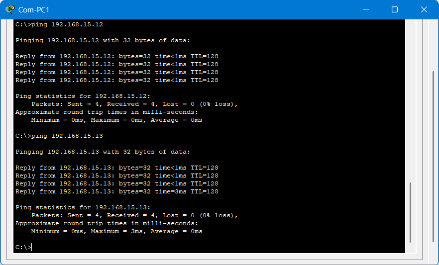 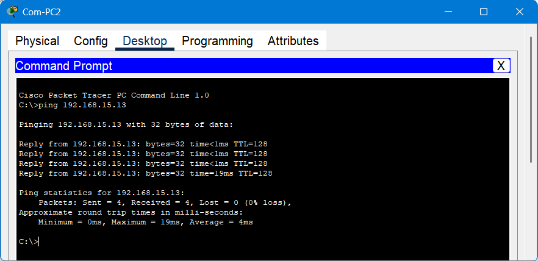 |
| Residencial |  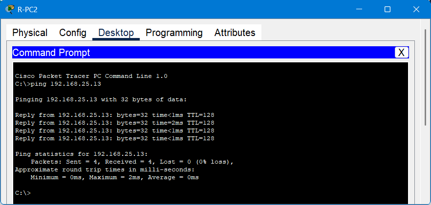 |
| Entretenimiento | 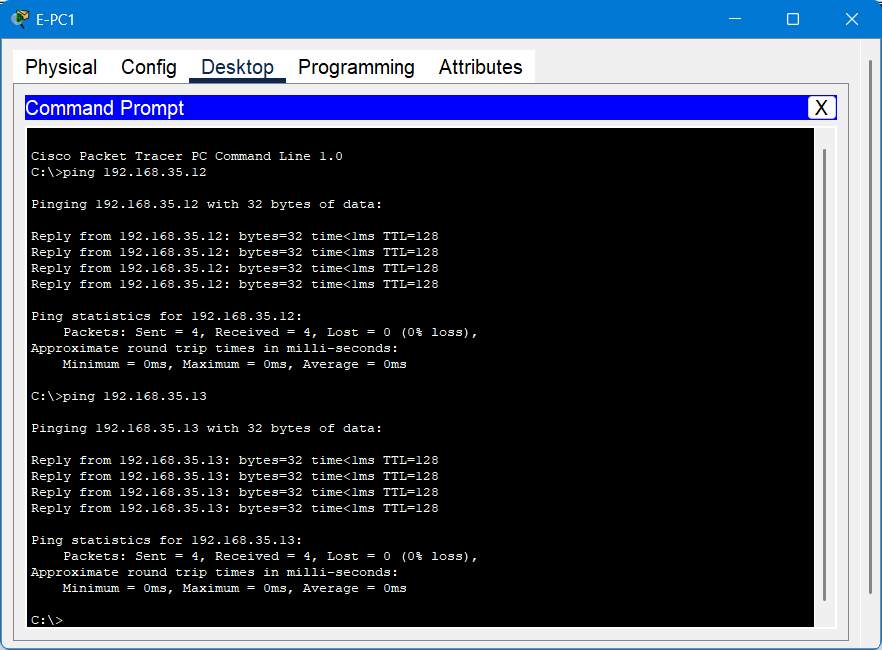 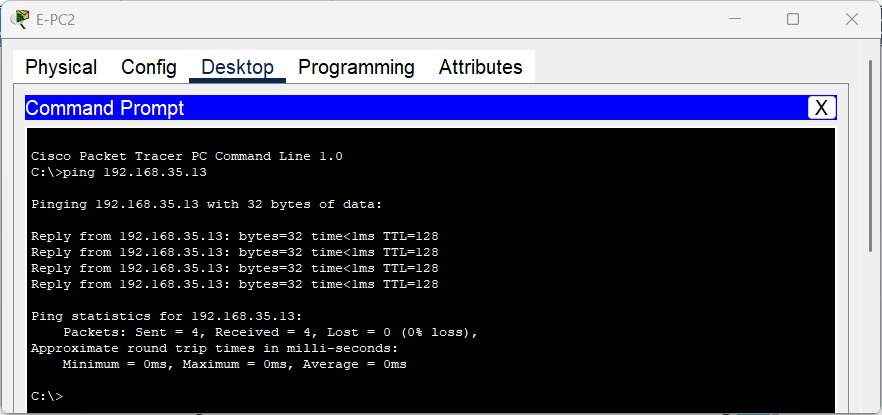 |
| Corporativo | 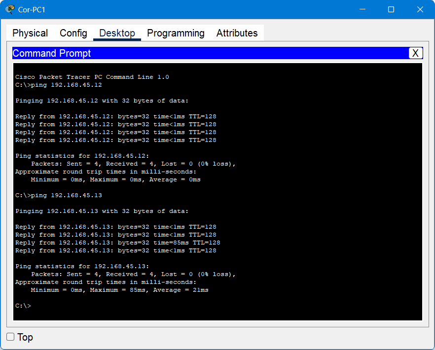 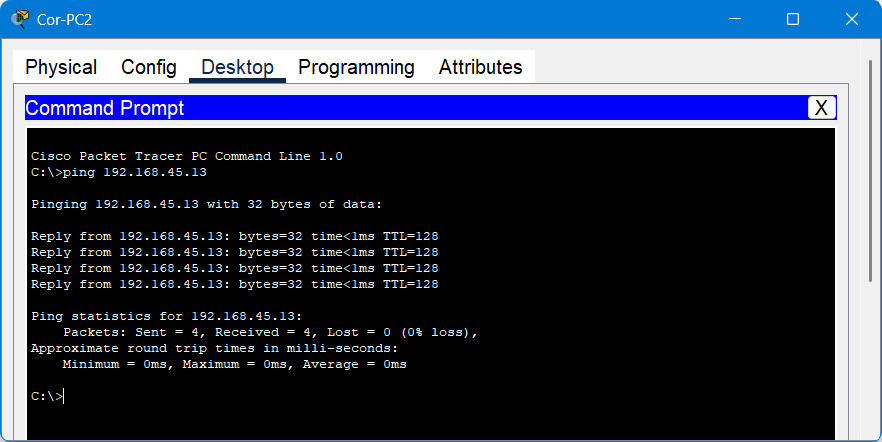 |
| Seguridad | 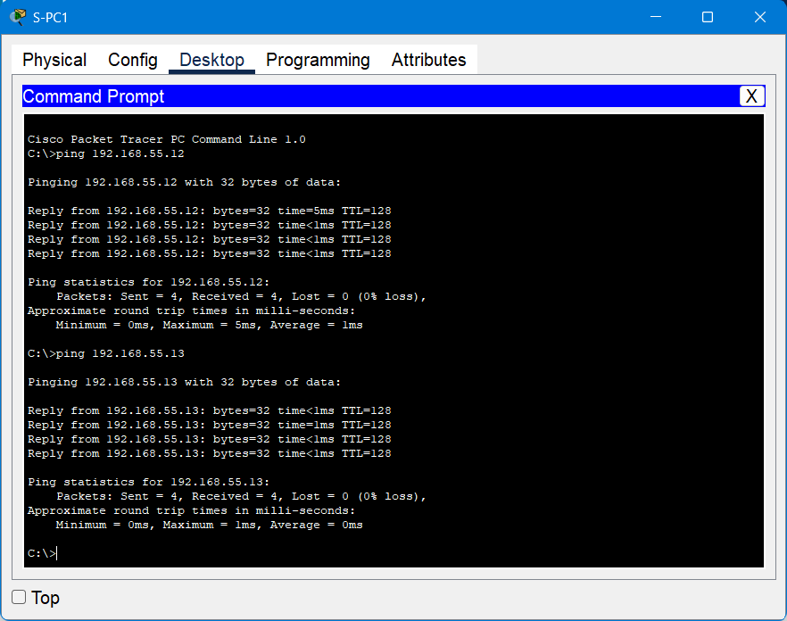  |

### 2.2 Entre zonas

Se probaron las 10 parejas de zonas, todas con 4/4 respuestas y TTL 127 (el salto por el núcleo resta 1 al TTL).

| Origen | Destino | Captura |
|---|---|---|
| Com-PC1 | R, E, Cor y S | 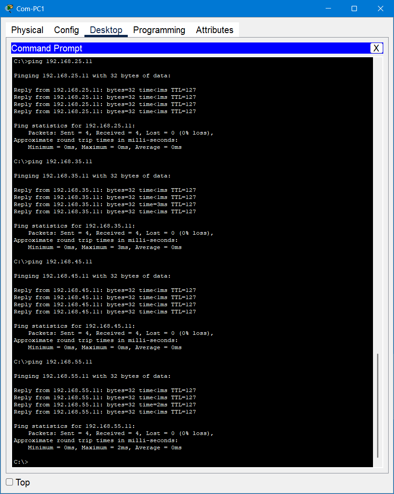 |
| R-PC1 | E, Cor y S | 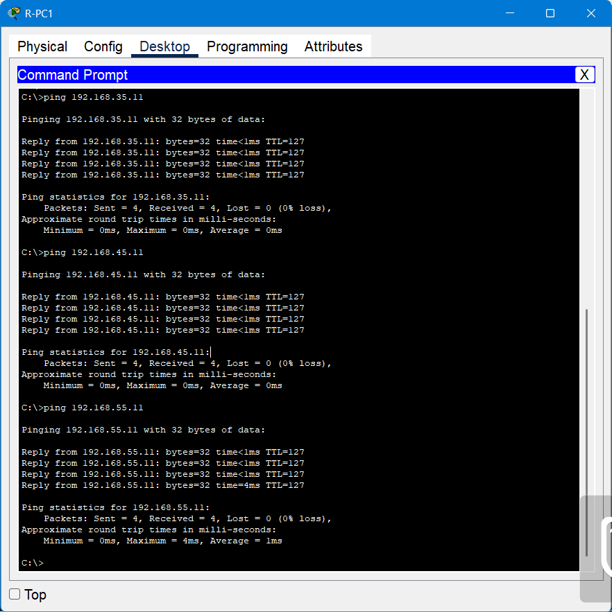 |
| E-PC1 | Cor y S | 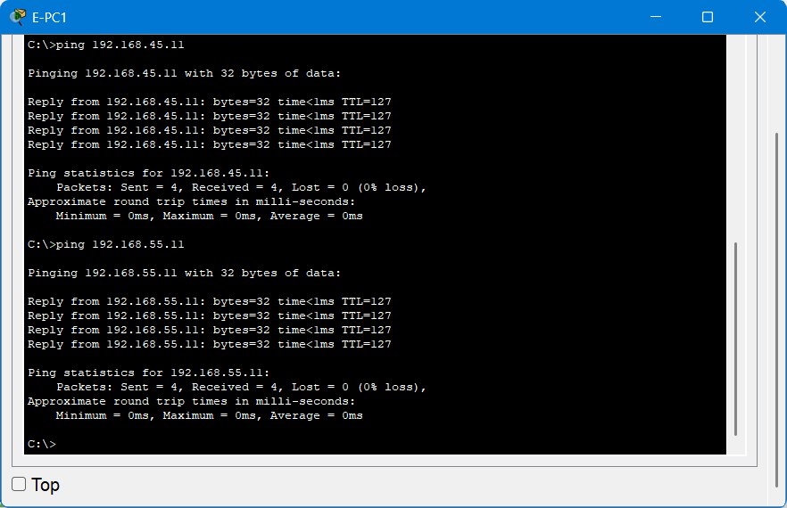 |
| Cor-PC1 | S | 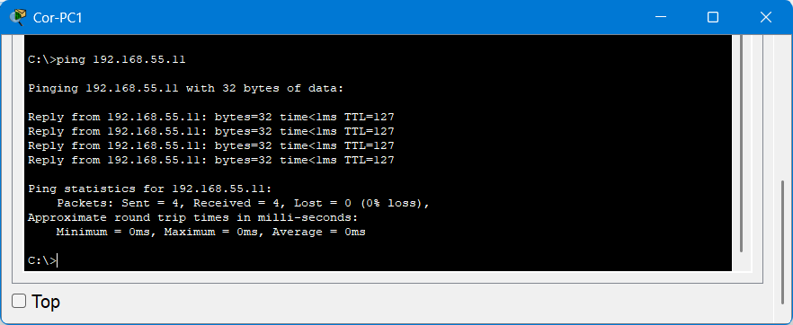 |

### 2.3 Fallas de enlace

**Falla de un cable del EtherChannel de la Zona 1:** Se apagó `Gig0/1` del núcleo con un ping continuo desde `Com-PC1` hacia `R-PC1`. El canal siguió en uso (`Po1(SU)` con `Gig0/1(D)` y `Gig0/2(P)`) y el ping respondió 34 de 35 veces, el único paquete perdido fue el primero, por la resolución ARP.

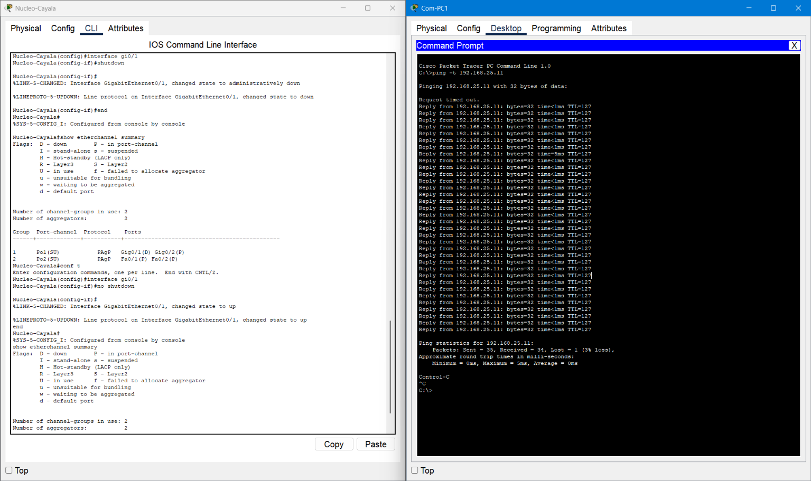

**Falla del enlace principal de la Zona 5:** Se apagó `Fa0/5` del núcleo. Para la VLAN 55, el núcleo pasó de tener `Fa0/5` como puerto raíz y `Po1` bloqueado a usar `Po1` como puerto raíz (costo 22), y `S-PC1` siguió alcanzando su gateway (4/4) y a `Com-PC1` (3/4, con el primer paquete perdido por ARP) a través de Z1.

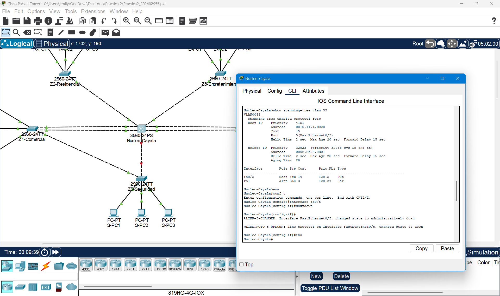

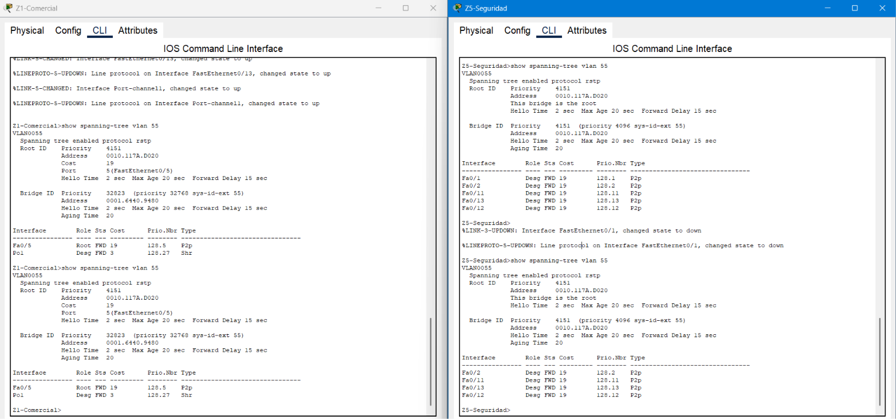

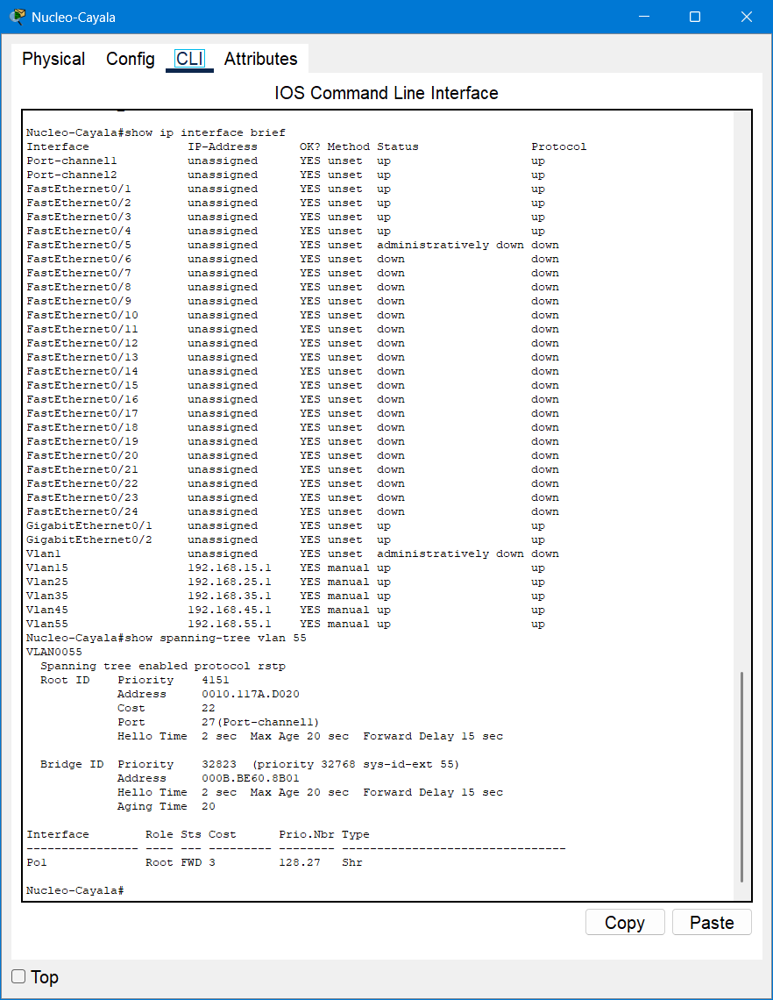

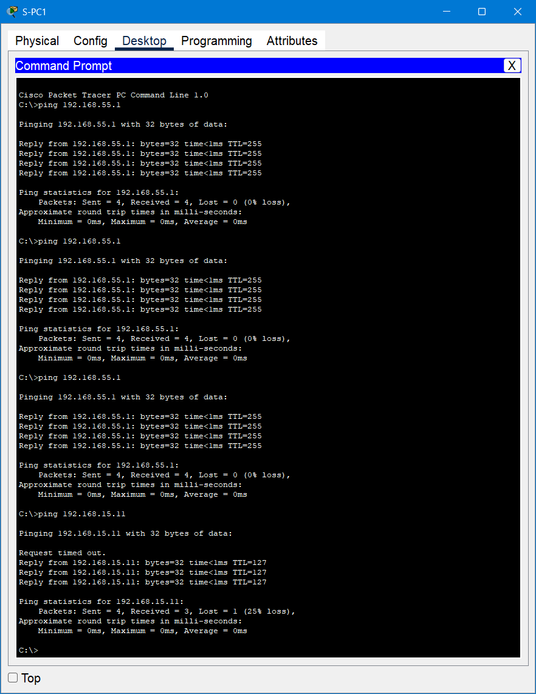

Después de las pruebas se restauraron los enlaces y la red volvió a su estado original.

## 3. Conectividad y aislamiento

Cada VLAN es un dominio de broadcast separado, por lo que las zonas están aisladas en capa 2. La comunicación entre zonas solo es posible a través del gateway del núcleo, que es lo que permitió verificar la conectividad entre todas ellas.

## 4. Problemas encontrados y soluciones

- **Fibra óptica no soportada.** Al intentar conectar un cable de fibra entre los switches, Packet Tracer respondió "The cable cannot be connected to that port". Se resolvió usando UTP, puertos Gigabit y EtherChannel para dar más capacidad a las zonas de alto tráfico.
- **VTP con seis servidores.** Un servidor desactualizado puede sobrescribir las VLANs de los demás. Se crearon las VLANs de una en una, verificando con `show vlan brief` antes de crear la siguiente. Los 6 switches terminaron con la misma revisión (14) y las 7 VLANs.

 

La red cumple los requisitos de la práctica: cada zona tiene su VLAN y su switch principal, las zonas críticas tienen al menos dos enlaces físicos y se verificó la conectividad dentro de cada zona y entre todas ellas, incluso con enlaces caídos.

---