# Manual Técnico — Práctica 2
## Red de la Ciudad Comercial Cayalá

## 1. Introducción

Se diseñó e implementó en Cisco Packet Tracer la red de 5 zonas de la Ciudad Comercial Cayalá. Cada zona tiene su propia VLAN y su propio switch principal, y todas se interconectan mediante un switch multicapa que actúa como núcleo y enruta entre ellas. La red usa VLANs, VTP, Rapid-PVST+ y EtherChannel con PAgP (carnet impar). Todos los switches se configuraron por CLI. Las pruebas de funcionamiento y los problemas encontrados están en `Informe_Desarrollo.md`, y los comandos de cada switch, en `scripts/Practica2_comandos_CLI.txt`.

## 2. Zonas seleccionadas

| Zona | VLAN | Hosts necesarios | Rol operativo | Volumen de tráfico estimado | Criticidad |
|---|---|---|---|---|---|
| Zona 1: Comercial y gastronómica (Paseo Cayalá) | 15 | 60 | Tiendas, restaurantes y servicios abiertos al público, usuarios: comercios y visitantes | Alto: terminales de venta y pagos continuos | Alta: una caída detiene las ventas |
| Zona 2: Residencial | 25 | 28 | Condominios y apartamentos, usuarios: residentes | Medio: navegación y entretenimiento en el hogar | Baja: afecta comodidad, no la operación del complejo |
| Zona 3: Entretenimiento (cine y centro de convenciones) | 35 | 12 | Taquillas, administración de salas y eventos | Bajo a medio, con picos en horarios de función y eventos | Baja a media |
| Zona 4: Corporativa y empresarial | 45 | 50 | Oficinas y espacios de trabajo, usuarios: empleados | Alto en horario laboral | Alta: una caída detiene la actividad empresarial |
| Zona 5: Seguridad y administración | 55 | 7 | Monitoreo, control de accesos y administración central | Bajo en volumen, pero constante | Máxima: seguridad del complejo las 24 horas |

La Zona 5 tiene pocos hosts pero es la más crítica, por lo que su diseño prioriza la redundancia sobre la capacidad. Por cada VLAN se instalaron 3 PCs representativas de la zona, la subred de cada VLAN tiene capacidad para los hosts necesarios de la tabla.

## 3. Topología

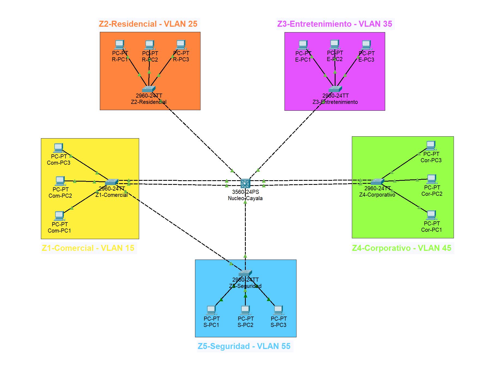

La topología es **híbrida** y combina dos tipos:
- **Estrella extendida:** el switch `Nucleo-Cayala` se conecta con un enlace troncal punto a punto a cada uno de los switches principales de zona.
- **Malla parcial:** las zonas críticas tienen enlaces redundantes. Zona 1 y Zona 4 tienen doble enlace al núcleo agrupado en EtherChannel, y Zona 5 tiene un segundo camino hacia el núcleo a través de Zona 1 formando el triángulo Núcleo–Z1–Z5.

| Switch | Modelo | Rol |
|---|---|---|
| Nucleo-Cayala | Cisco 3560-24PS (multicapa) | Núcleo, enrutamiento entre VLANs |
| Z1-Comercial | Cisco 2960-24TT | Switch principal de la Zona 1 |
| Z2-Residencial | Cisco 2960-24TT | Switch principal de la Zona 2 |
| Z3-Entretenimiento | Cisco 2960-24TT | Switch principal de la Zona 3 |
| Z4-Corporativo | Cisco 2960-24TT | Switch principal de la Zona 4 |
| Z5-Seguridad | Cisco 2960-24TT | Switch principal de la Zona 5 |

## 4. Enlaces físicos y justificación

| Enlace | Puertos | Cable | Justificación |
|---|---|---|---|
| Núcleo ↔ Z1 (Po1) | Gig0/1-2 ↔ Gig0/1-2 | UTP Cat6 cruzado ×2 | Zona con más hosts (60) y tráfico comercial, 2 enlaces físicos para alta disponibilidad y 2 Gbps de capacidad agregada |
| Núcleo ↔ Z4 (Po2) | Fa0/1-2 ↔ Fa0/1-2 | UTP Cat6 cruzado ×2 | 50 hosts de alta actividad en horario laboral, alta disponibilidad y 200 Mbps agregados, menos que Z1 porque tiene menos hosts |
| Núcleo ↔ Z2 | Fa0/3 ↔ Fa0/1 | UTP Cat6 cruzado | Zona residencial no crítica, un solo enlace es suficiente |
| Núcleo ↔ Z3 | Fa0/4 ↔ Fa0/1 | UTP Cat6 cruzado | Zona de pocos hosts y criticidad baja, un solo enlace |
| Núcleo ↔ Z5 | Fa0/5 ↔ Fa0/1 | UTP Cat6 cruzado | Enlace principal de la zona de seguridad |
| Z5 ↔ Z1 | Z5 Fa0/2 ↔ Z1 Fa0/5 | UTP Cat6 cruzado | Segundo enlace físico de la zona crítica, independiente del núcleo, en operación normal STP lo mantiene bloqueado y entra en servicio si falla el enlace principal |
| Switch ↔ PC | Fa0/11, 12 y 13 del switch de zona | UTP Cat6 directo | Dispositivos distintos: se usa cable directo según TIA/EIA-568B |

**Medios de transmisión.** Todos los enlaces son de cobre UTP. Entre switches se usó cable cruzado y hacia las PCs cable directo, siguiendo el estándar TIA/EIA-568B. La capacidad se diferencia por zona usando puertos Gigabit en la Zona 1 y puertos FastEthernet en el resto, más la agregación con EtherChannel. En el simulador, los modelos 2960-24TT y 3560-24PS no aceptaron cable de fibra óptica, en un despliegue real los tramos mayores a 100 m entre zonas se resolverían con fibra.

## 5. Dominios de colisión

Todos los enlaces son punto a punto en full-duplex y no hay hubs ni repetidores, por lo que cada cable es un dominio de colisión independiente. Los switches son los dispositivos que los delimitan: cada puerto activo termina un dominio.

| Switch | Puertos activos | Cantidad |
|---|---|---|
| Nucleo-Cayala | Gig0/1-2, Fa0/1-5 | 7 |
| Z1-Comercial | Gig0/1-2, Fa0/5, Fa0/11-13 | 6 |
| Z2-Residencial | Fa0/1, Fa0/11-13 | 4 |
| Z3-Entretenimiento | Fa0/1, Fa0/11-13 | 4 |
| Z4-Corporativo | Fa0/1-2, Fa0/11-13 | 5 |
| Z5-Seguridad | Fa0/1-2, Fa0/11-13 | 5 |

La suma de puertos activos es 31, pero cada enlace entre switches se cuenta en dos puertos. La topología tiene **23 dominios de colisión**: 8 enlaces entre switches y 15 enlaces a PCs.

Esta segmentación es adecuada porque ninguna PC compite por el medio con otra ya que cada una tiene su propio enlace dedicado al switch, lo que elimina las colisiones y permite que las zonas de alto tráfico (Zona 1 y Zona 4) funcionen sin degradarse. Además, el tráfico de broadcast queda limitado a 5 dominios siendo uno por VLAN.

## 6. VLANs y direccionamiento

| VLAN | Nombre | Subred | Gateway (SVI en el núcleo) | Hosts necesarios | PCs implementadas |
|---|---|---|---|---|---|
| 15 | COMERCIAL | 192.168.15.0/24 | 192.168.15.1 | 60 | Com-PC1, 2, 3 (.11, .12, .13) |
| 25 | RESIDENCIAL | 192.168.25.0/24 | 192.168.25.1 | 28 | R-PC1, 2, 3 (.11, .12, .13) |
| 35 | ENTRETENIMIENTO | 192.168.35.0/24 | 192.168.35.1 | 12 | E-PC1, 2, 3 (.11, .12, .13) |
| 45 | CORPORATIVO | 192.168.45.0/24 | 192.168.45.1 | 50 | Cor-PC1, 2, 3 (.11, .12, .13) |
| 55 | SEGURIDAD | 192.168.55.0/24 | 192.168.55.1 | 7 | S-PC1, 2, 3 (.11, .12, .13) |
| 99 | NATIVA | | | VLAN nativa de todos los troncales | |
| 999 | BLACKHOLE | | | Puertos sin usar | |

**Por qué un /24 por VLAN.** Se usan direcciones privadas, por lo que no hay escasez de espacio. Un /24 (254 hosts utilizables) cubre con holgura el máximo de 60 hosts de cualquier zona, deja margen de crecimiento y simplifica la administración porque el tercer octeto de la dirección coincide con el ID de la VLAN. No se usó VLSM porque no hay un bloque limitado que haya que subdividir.

Todos los puertos sin usar de los 6 switches están asignados a la VLAN 999 (por ejemplo, en el núcleo `Fa0/6-24`).

## 7. VTP

Los 6 switches comparten el dominio VTP `202402955` (carnet) con una contraseña común `Cayala2026`. Todos están en modo **server**, de modo que cada switch principal de zona administra la VLAN de su zona y el resto se sincroniza por VTP. Las VLANs 99 y 999 se crearon en el núcleo. Para evitar que un servidor desactualizado sobrescribiera la base de datos de los demás, las VLANs se crearon de una en una comprobando con `show vlan brief` que el siguiente switch ya mostrara las anteriores.

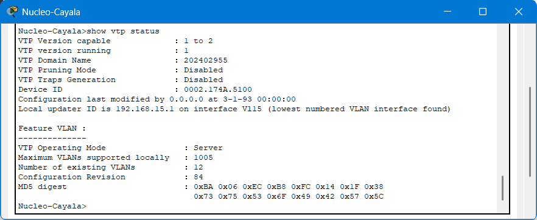

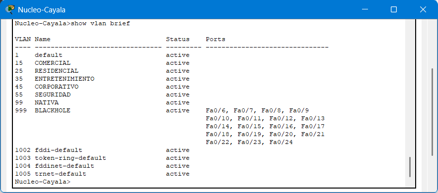

## 8. Troncales y VLAN nativa

Los troncales usan 802.1Q con VLAN nativa 99 y permiten solamente las VLANs necesarias (no "all"):

| Enlace | VLANs permitidas |
|---|---|
| Núcleo ↔ Z1 (Po1) | 15, 55, 99 |
| Núcleo ↔ Z4 (Po2) | 45, 99 |
| Núcleo ↔ Z2 | 25, 99 |
| Núcleo ↔ Z3 | 35, 99 |
| Núcleo ↔ Z5 | 55, 99 |
| Z5 ↔ Z1 | 55, 99 |

El troncal Núcleo ↔ Z1 incluye la VLAN 55 para que el camino de respaldo de Seguridad (Z5 → Z1 → Núcleo) pueda llegar al núcleo.

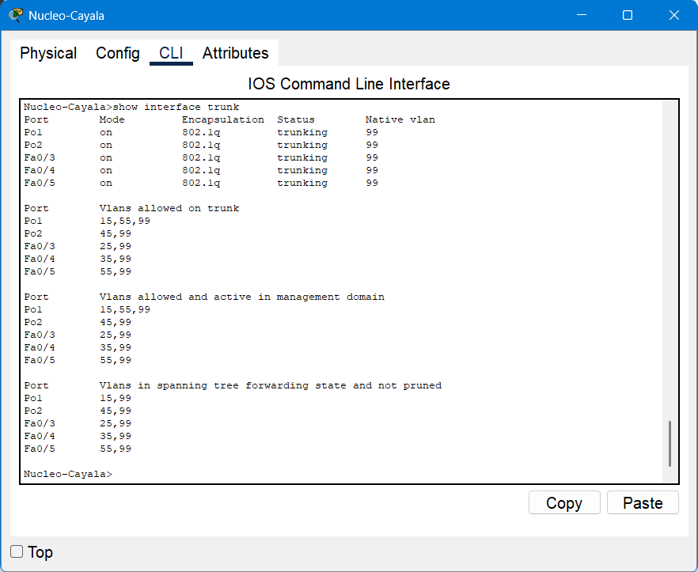

## 9. Rapid-PVST+ y Root Bridge

Todos los switches usan Rapid-PVST+. El switch principal de cada zona es el root bridge de su VLAN, con prioridad explícita de 4096. La prioridad que muestra el switch es 4096 más el ID de la VLAN.

| VLAN | Root bridge | Prioridad configurada | Prioridad mostrada | Justificación |
|---|---|---|---|---|
| 15 | Z1-Comercial | 4096 | 4111 | Switch principal de la zona a la que pertenece la VLAN |
| 25 | Z2-Residencial | 4096 | 4121 | Ídem |
| 35 | Z3-Entretenimiento | 4096 | 4131 | Ídem |
| 45 | Z4-Corporativo | 4096 | 4141 | Ídem |
| 55 | Z5-Seguridad | 4096 | 4151 | Ídem |
| 99 | Nucleo-Cayala | 4096 | 4195 | Es la VLAN nativa que viaja por todos los troncales y el núcleo es el punto central |

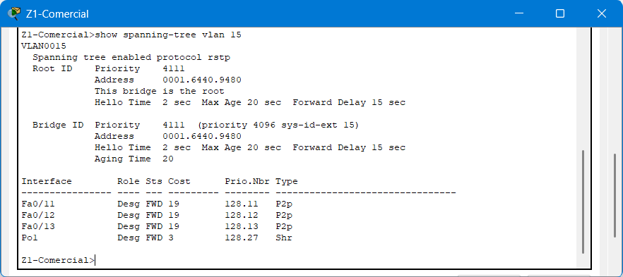

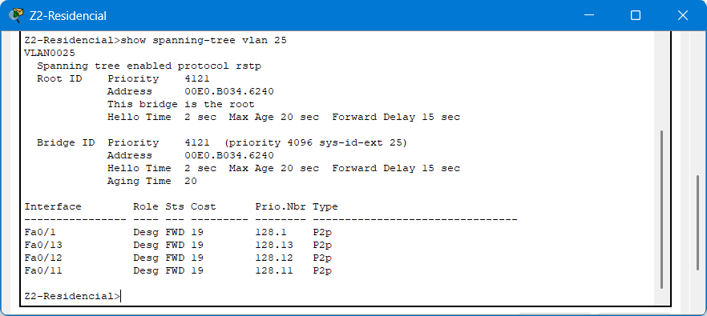

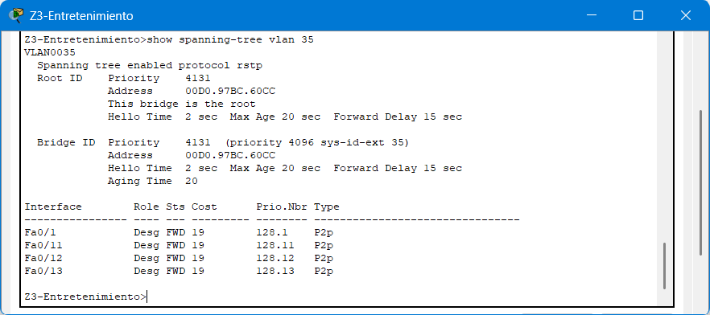

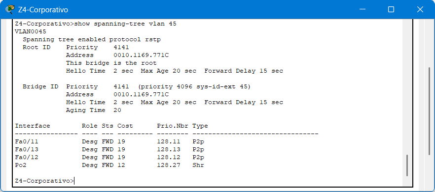

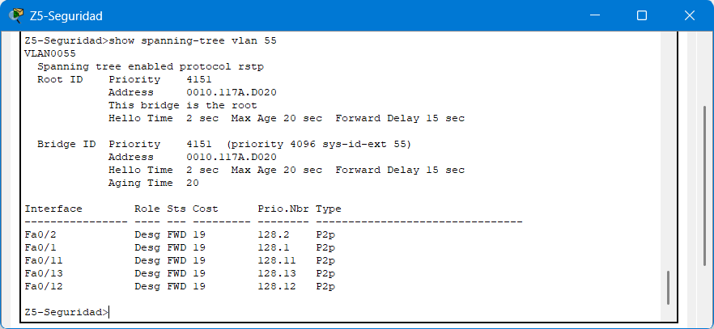

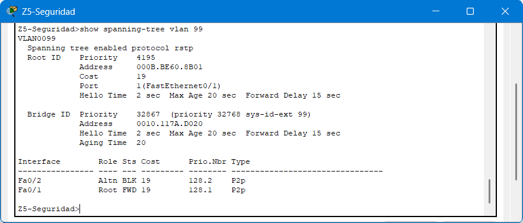

## 10. EtherChannel

Se usó PAgP porque el último dígito del carnet es impar.

- **Núcleo ↔ Z1 (Po1, 2 × Gigabit):** la Zona 1 tiene la mayor cantidad de hosts (60) y el tráfico comercial más alto del complejo. El canal suma 2 Gbps y sigue funcionando si cae uno de los cables.
- **Núcleo ↔ Z4 (Po2, 2 × FastEthernet):** la Zona 4 tiene 50 hosts de oficina. El canal suma 200 Mbps y también tolera la caída de un cable. Tiene menos capacidad que Z1 porque tiene menos hosts.

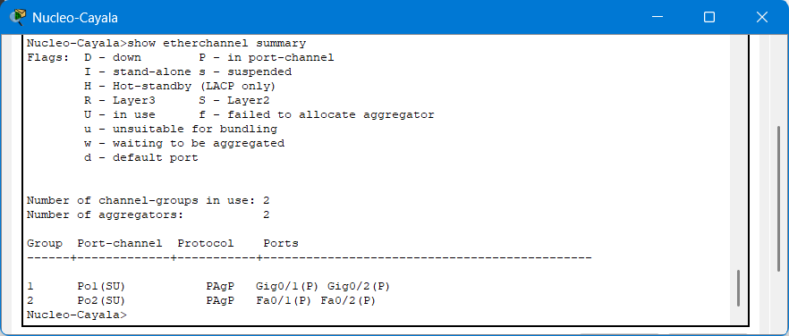

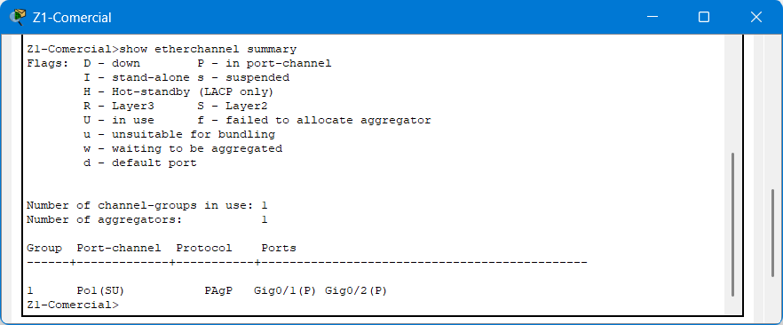

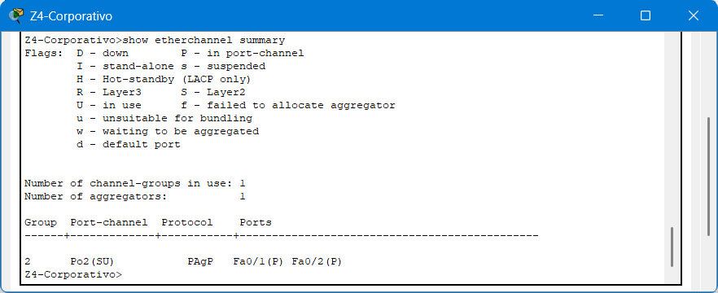

## 11. Enrutamiento entre zonas

El núcleo tiene `ip routing` y una interfaz virtual (SVI) por VLAN, que es el default gateway de las PCs de su zona.

Las VLANs mantienen separado el dominio de broadcast de cada zona. El tráfico entre zonas solo puede pasar por el gateway del núcleo, que es lo que permite verificar la conectividad entre todas las zonas.

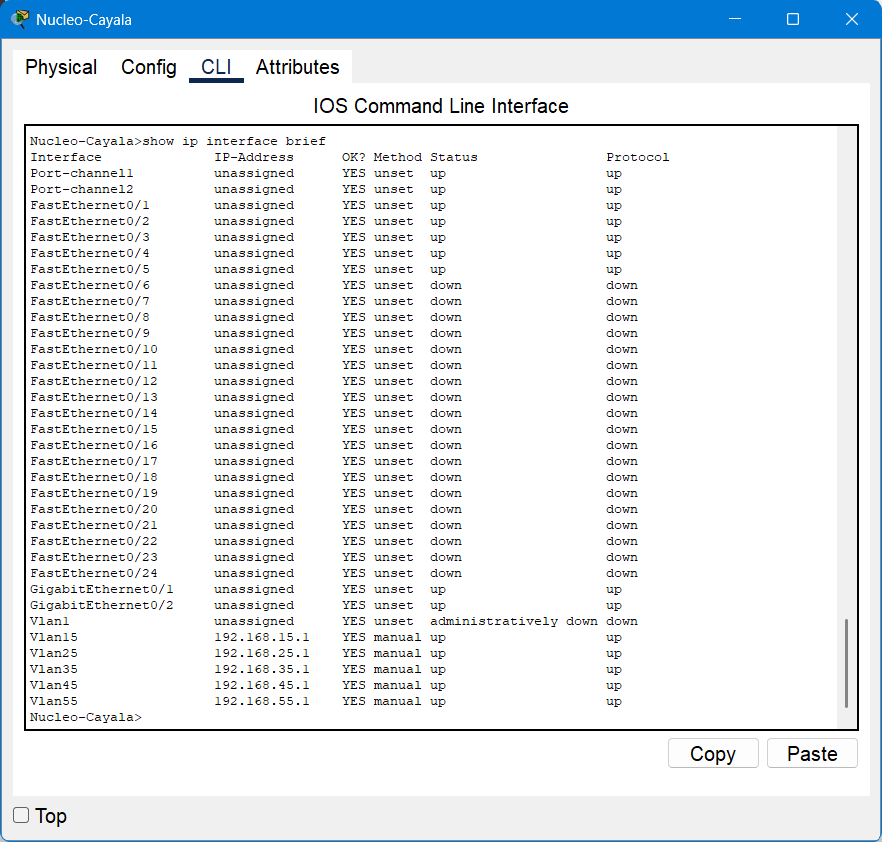

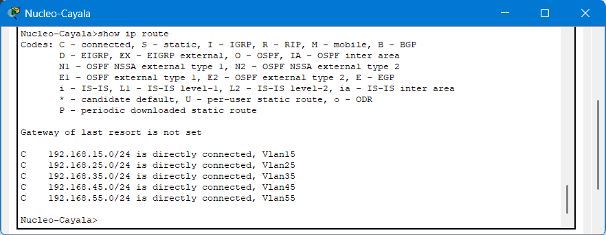
